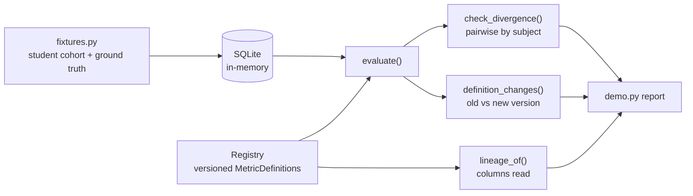

# metricregistry

Executable, versioned KPI definitions with a divergence monitor that flags when metrics claiming to measure the same thing disagree.

[](https://github.com/bkc021102/metricregistry/actions/workflows/ci.yml)

## Why

Finance, the registrar and marketing each report a different number of enrolled
students. All three are defensible: they use different census dates and treat
withdrawals and deferrals differently. A glossary written in English cannot fix
this, because it drifts from the SQL and has no way to notice. In metricregistry
a definition *is* its SQL, so it executes, produces a value, and can be compared
against every other definition of the same subject.

## Features

- Versioned metric definitions carrying SQL, grain, owner, description and tolerance.
- Immutable versions: registering an existing `name@version` raises, so amendments become new versions.
- Divergence monitor that evaluates every definition and compares each pair that shares a subject, worst gap first.
- Per-pair tolerance (the tighter of the two definitions wins), with a negative case so the monitor stays quiet when definitions agree.
- Definition change log showing how far a number moved because its *definition* changed.
- Column lineage for each definition.
- Synthetic student cohort with ambiguous cases and ground-truth counts per definition.

## Architecture



Definitions live in a `Registry`. `evaluate` runs a definition's SQL against a
SQLite connection. The monitor groups current definitions by `subject` and
compares every pair; the change log evaluates consecutive versions of the same
metric. See [docs/ARCHITECTURE.md](docs/ARCHITECTURE.md).

## Quick start

Requires Python 3.11+. There are no dependencies; everything uses the standard library.

```bash
git clone https://github.com/bkc021102/metricregistry.git
cd metricregistry
python -m unittest discover -s tests -v   # run the tests
python -m src.demo                        # run the walkthrough
```

## Example

`python -m src.demo` (trimmed):

```text
  THE NUMBERS IN THE ROOM
    finance             13,990   Fee-liable students: enrolled at any point up to the census date and not withdrawn by it.
    marketing           14,560   Conversions: anyone who ever enrolled, ...
    registry-office     13,570   Students enrolled on or before term start who had not withdrawn or deferred ...

  THE MONITOR
    [ALERT] enrolled_students: enrolled_students_marketing (v1) = 14,560 vs enrolled_students_registrar (v1) = 13,570 (6.80% apart, tolerance 0.50%)
    [ALERT] enrolled_students: enrolled_students_finance (v1) = 13,990 vs enrolled_students_marketing (v1) = 14,560 (3.91% apart, tolerance 0.50%)
    [ALERT] enrolled_students: enrolled_students_finance (v1) = 13,990 vs enrolled_students_registrar (v1) = 13,570 (3.00% apart, tolerance 0.50%)
    [ok   ] applications: applications_received (v1) = 17,100 vs applications_total (v1) = 17,100 (0.00% apart, tolerance 0.50%)

  WHEN A NUMBER MOVES BECAUSE THE DEFINITION MOVED
    enrolled_students_finance v1 -> v2: 14,560 -> 14,300 (-260)
```

Using the library directly:

```python
from src.fixtures import REGISTRY, build
from src.registry import breaches

conn, expected = build()
for d in breaches(conn, REGISTRY):
    print(d.describe())
```

## How it works

- **Evaluation.** `evaluate(conn, definition)` runs the SQL and takes the first column of the first row; no row or NULL becomes `0.0`.
- **Divergence.** Relative gap is `|a - b| / max(|a|, |b|)`. A pair breaches when the gap exceeds the smaller of the two tolerances (default 0.5%).
- **Change log.** For each consecutive pair of versions, both are evaluated on the same data and the difference is reported, separating definition-driven movement from real movement.
- **Lineage.** Regular expressions pick out `table.column` references and columns in `WHERE`/`AND`/`OR` comparisons. It is deliberately conservative, not a SQL parser.
- **Fixture ground truth.** `build()` returns expected counts per definition computed from the cohort's known case sizes, not from the SQL, so tests check definitions against an independent answer.

## Testing

```bash
python -m unittest discover -s tests -v
```

The 16 tests cover: each definition returning its documented value on the
ambiguous cases (withdrawal before and after census, late enrolment, deferral,
dual enrolment), the three enrolment numbers differing, the monitor firing on
enrolment and staying silent on applications, pair coverage and ordering, tolerance
selection, version immutability, the change log, and lineage.

## Project layout

```text
src/registry.py     definitions, registry, evaluator, monitor, change log, lineage
src/fixtures.py     synthetic student cohort, ground truth, sample registry
src/demo.py         side-by-side report
tests/              unittest suite
docs/               architecture notes
```

## Limitations

- SQLite only; definitions are plain SQL strings, not a dbt or MetricFlow model.
- The monitor is a function, not a scheduler or alerting service, and there is no UI.
- Lineage is regex-based and can miss or over-report columns in complex SQL.
- It does not pick a canonical definition; that is a policy decision.

## License

MIT, see [LICENSE](LICENSE).

## Maintainer

Maintained by **KRISHNA CHAITANYA BHUPATHI RAJU**, Data Analyst, with experience in SQL, Python, analytics, and data governance. For project questions, contact [Email](mailto:krishna.chaitanya007@outlook.com) or connect on [LinkedIn](https://www.linkedin.com/in/bkrishna-chaitanya/).

Original project by [bkc021102](https://github.com/bkc021102).