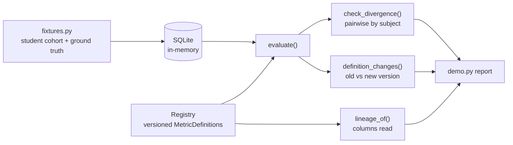

# Architecture

## Context

Different teams count "enrolled students" differently, because they use
different census dates and different treatments of withdrawals and deferrals.
Each count is defensible; the problem is that nothing records *why* they differ
or notices when a definition changes. metricregistry stores each KPI as an
executable, versioned definition and continuously compares definitions that
claim to measure the same thing.

## Components

- `src/registry.py` holds `MetricDefinition`, `Registry`, the evaluator, the
  divergence monitor, the change log and lineage extraction.
- `src/fixtures.py` builds a synthetic student table with deliberately
  ambiguous cases and returns the expected count under each definition,
  derived from the generator's counts rather than from the SQL.
- `src/demo.py` prints the side-by-side report.

## Key decisions

- **A definition is its SQL.** A definition that cannot execute is not a
  definition, so the description is metadata and the SQL is the source of truth.
  Trade-off: definitions are tied to one SQL dialect (SQLite here).
- **Definitions are immutable.** Registering an existing `name@version` raises;
  amending means publishing a new version. This is what makes the change log
  possible.
- **Subjects group metrics expected to agree.** The monitor compares every pair
  within a subject. Tolerance is the tighter of the two definitions' tolerances.
- **No canonical number is chosen.** The tool makes disagreement visible and
  attributable; picking a policy is a human decision.
- **Conservative lineage.** Column lineage is extracted with regular
  expressions, so it can over- or under-report on complex SQL.

## Failure modes

- A definition whose SQL raises surfaces the database error rather than
  returning a placeholder value.
- A query that returns no rows or NULL evaluates to `0.0`.
- A monitor that alerts on everything gets ignored, so a test asserts it stays
  silent for a subject where the definitions agree.

## Out of scope

- Rendering dashboards (it governs definitions; a BI tool displays them).
- Scheduling; the monitor is a function you call from whatever scheduler you use.
- Non-SQLite backends.
